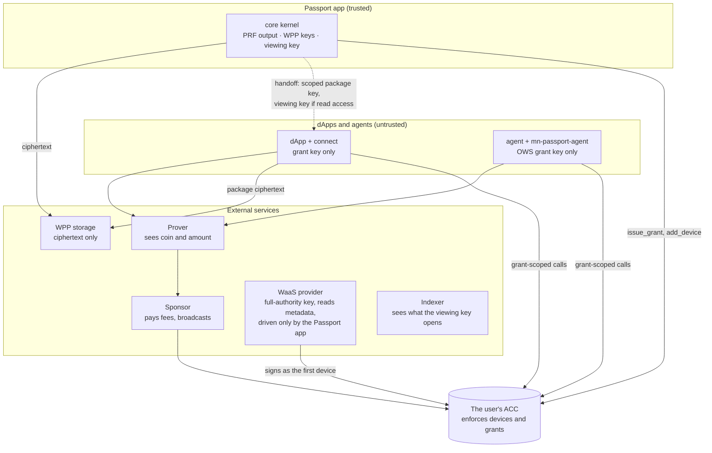

# Midnight Passport SDK architecture

> **Status:** draft · 2026/10/19
> **Owns:** the packages, the seams, the adapters, and the dependency rules of
> the SDK.
> **Companions:** [`sdk-requirements.md`](./sdk-requirements.md) (what the SDK
> must do), [`compatibility.md`](./compatibility.md) (the version axes), and
> [`beta-scope.md`](./beta-scope.md) (what beta contains).

## Summary

- The SDK has **three entry libraries** on a **shared foundation**. `core` is
  the engine of the Passport app. `connect` is the dApp library.
  `mn-passport-agent` is the agent library.
- **After V1**, a fourth entry library, `mn-passport-ecosystems`, shows
  Passport in the wallet pickers of other chains, such as Solana and EVM
  chains.
- The foundation has three packages: `mn-passport-account` (the ACC client and
  the shared seams), `mn-passport-contract` (bindings and artifacts), and
  `mn-passport-protocol` (wire messages).
- **`connect` and `mn-passport-agent` never link `core`.** Code that more than
  one entry library needs goes into `mn-passport-account`.
- Most seams live in `mn-passport-account`, so that the three entry libraries
  share one prover, one broadcast client, and one key-provider interface.
  Storage, recovery, and DID stay behind `core`.
- **Transaction in, proof out.** The prover gets the unproven transaction and
  holds the proving keys. In V1, the prover sees the coin and the amount, and
  the user is told.
- After the grant and the handoff, a dApp or an agent operates with the
  Passport app closed. It signs with its own grant key, never through Passport.
- **A dApp never onboards a user.** It sends a new user to the Passport app.
  The app onboards the user and issues the grant of the dApp in the same visit.
- **A user never holds DUST.** A sponsor pays the fees, or the user swaps for
  them through the Capacity Exchange.

## The package map


_The entry libraries depend on the foundation. The shared adapters implement
seams from `mn-passport-account`, and the registry adapter implements a seam
from `mn-passport-contract`. The Passport-app adapters implement seams from
`core`, and only `core` uses them._

## Design approach

The requirements fix three ingredients: typed packages with a clean split, a
kernel secret boundary, and a reactive state model. The approaches differ only
in how many of them V1 adopts.

| Approach | Shape | Verdict |
|---|---|---|
| 1. Thin typed wrappers | Typed bindings and injected providers. No kernel, no reactive surface. | Rejected as a target. It does not contain secrets or discipline state. |
| 2. Layered core and adapters | A minimal kernel boundary, seams as adapter packages, observable reads, and imperative writes | **V1.** |
| 3. Kernel, adapters, and a command bus | Each mutation goes through one pipeline: authorize, build, prove, broadcast, confirm. | The target end state. |

V1 builds approach 2 with seams that already have the approach 3 shape. Thus,
approach 3 is an evolution, not a rewrite.

## Packages

All packages publish under the `@midnight-ntwrk/` scope.

### Entry libraries

| Package | Runs in | What it does |
|---|---|---|
| `mn-passport-core` | The Passport app (browser) | Onboarding, devices, grant issuance and revocation (the authorizer page of MIP §9), and recovery. It also onboards a new user who arrives from a dApp, and then issues the grant of that dApp (example 2). It keeps private data through WPP and gives out the viewing key. It recognizes an account from the passkey and its largeBlob. It is not on the path of a dApp or an agent. |
| `mn-passport-connect` | A dApp (browser) | The grant ceremony with the browser profile. The per-origin key provider. The signature of the ACC challenge with the grant key. The private-data handoff, then a private-state provider over the WPP package of the dApp. Pay with Passport. It never onboards a user: it sends a new user to the Passport app (example 2). |
| `mn-passport-agent` | An agent backend (Node.js) | The grant ceremony with the agent profile. OWS as the key provider. On-chain grant reads, so that OWS can enforce the grant as its policy. A registry client that gets and runs the circuit of a dApp. |
| `mn-passport-ecosystems` | A dApp on a different chain (browser) | **After V1.** It registers Passport in the wallet standards of other chains: `/solana` for the Solana Wallet Standard, and `/evm` for EIP-6963 and EIP-1193. It holds no key. It sends each request to the Passport app (example 8). |

### Foundation

| Package | What it does |
|---|---|
| `mn-passport-account` | The ACC client that the three entry libraries share. It builds and signs ACC challenges for each arm, and it reads grants on chain. It has the grant-ceremony client, the coin store, the inbox codec, payments, the transaction joiner, and the grant-scope helpers. It defines the shared seams. |
| `mn-passport-contract` | Typed bindings over the published ACC artifact, the version registry, and the integrity checks. It loads the compiled module, the ledger decoder, and the manifest. It loads the ZKIR only for a client that verifies circuits. It accepts a partly deployed account. It publishes the interface of the ACC for dApp circuits, and it defines the registry seam. |
| `mn-passport-protocol` | The MIP §9 messages: the grant request, the possession proof, the redirect response, and the sign-in message (MIP §10). It also carries the shared constants: the RP ID, the PRF salt, and the largeBlob schema. Types and constants only, with no logic. |

## Seams

A seam is an interface with interchangeable adapters. A seam that more than one
entry library uses lives in the foundation.

| Seam | Shape (indicative) | Defined in | Used by | Implemented by |
|---|---|---|---|---|
| Key provider | `scheme`, `envelope`, `publicKey()`, `sign(challenge)` | `account` | All three | The key providers below |
| Prover | `prove(unprovenTx, circuitIds) → provenTx` | `account` | All three | `adapter-prover-remote` |
| Broadcast | `broadcast(provenTx)`, then monitor until final | `account` | All three | `adapter-broadcast` |
| Fees | A sponsor pays, or a Capacity Exchange swap | `account` | All three | `adapter-broadcast` (sponsor), `adapter-fee-capacity-exchange` |
| Platform | Network, WASM load order, WebAuthn or its Node.js equivalent | `account` | All three | `adapter-browser`, `adapter-nodejs` |
| Private state | The midnight-js `PrivateStateProvider` | `account` | `connect` (agents: open) | `connect`, over the WPP package of the dApp |
| Account metadata | Namespaced, versioned entries; read, merge, write, read back | `account` | `core` | `adapter-waas` |
| Registry | Get dApp artifacts by content hash, and verify them | `contract` | `mn-passport-agent` | The registry adapter |
| Multi-chain | Submit an authorized intent for a different chain, then report its settlement or its failure | `account` | All three | `adapter-multi-chain` |
| Storage | Ciphertext only: WPP packages, catalogs, conflict retention, backup states | `core` | `core` | `adapter-storage-wpp` |
| Recovery | Guardians and paper keys | `core` | `core` | `adapter-recovery` |
| DID | Create, link, sign, and resolve `did:midnight` | `core` | `core` | `adapter-did` |

### Key providers

A key provider holds a private key and signs an ACC challenge. The holder of a
key makes the key, and the Passport app registers it as a device (full
authority) or as a grant (scoped authority).

```ts
// Indicative shape; signatures are fixed when the package is specced.
interface KeyProvider {
  readonly scheme: 'jubjub' | 'k256' | 'p256';
  readonly envelope?: 0 | 1; // k256 only
  publicKey(): Promise<Uint8Array>;
  sign(challenge: Challenge): Promise<Authorization>;
}
```

| Key provider | Scheme | Usual registration | Lives in |
|---|---|---|---|
| Passkey | JubJub, from the PRF output | Device | `core` |
| Passkey on secp256r1 | p256, `wa-json134` WebAuthn profile only | Device or grant | `core`, `connect` |
| Embedded wallet of a WaaS provider | k256, envelope 0 | Device | `adapter-waas` |
| Midnight connector wallet | k256, envelope 1 (`signData` with `ecdsa_secp256k1_sha256`) | Device, or a read-only grant | `core`, `connect` |
| dApp per-origin key | JubJub, k256 (envelope 0), or p256 | Grant | `connect` |
| Agent key in OWS | JubJub or k256 (envelope 0) | Grant | `mn-passport-agent` |
| EVM wallet | k256, EIP-191 | **After V1.** Device or grant | `core`, `connect` |
| Solana wallet | Ed25519 | **After V1.** Device or grant | `core`, `connect` |

[`sdk-requirements.md`](./sdk-requirements.md) owns the exact signing digests.

An external wallet can sign for the ACC only on an arm that the ACC verifies.
The EVM wallet needs a new k256 envelope for EIP-191, and the Solana wallet
needs an Ed25519 arm. The contract team adds these arms. Then the key-provider
interface gets the new scheme or envelope.

## Adapters

Each adapter implements one seam. It depends only on the package that defines
the seam and on its own provider SDK.

### Shared adapters

dApps and agents need these adapters too. Thus, they implement seams from the
foundation, never from `core`.

| Adapter | Seam | Note |
|---|---|---|
| `adapter-prover-remote` | Prover | Transaction in, proof out. The prover holds the proving keys, or makes them again from the ZKIR and the on-chain verifier key. |
| `adapter-broadcast` | Broadcast, fees | Gives the proven transaction to the sponsor, which pays the fees and broadcasts it. Monitors until final, with bounded waits and resubmission. |
| `adapter-fee-capacity-exchange` | Fees | The other fee route: a swap through the Capacity Exchange. Planned for later. |
| `adapter-browser` | Platform | The browser runtime: passkeys with PRF and the two WASM runtimes in the correct order. |
| `adapter-nodejs` | Platform | The Node.js runtime for backends, `mn-passport-agent` included. |
| `adapter-waas` | Key provider, account metadata | The embedded key of a WaaS provider (k256, envelope 0) and the metadata on it. It names no vendor. Only `core` uses it, because this key is a full-authority device (example 2). |
| Registry adapter (name open) | Registry | Content-addressed fetch, verification, and a local cache. It makes the verifier key again from the ZKIR and the SRS, and compares it with the key on chain. |
| `adapter-multi-chain` | Multi-chain | **After V1.** It connects to a multi-chain signature network. The network signs for the ACC on other chains, after the ACC authorizes the intent. |
| `adapter-prover-wasm` | Prover | **After V1.** ACC proving keys are 112–224 MB, and the zkir WASM package has no key generation. |

### Passport-app adapters

Only `core` uses these adapters.

| Adapter | Seam | Note |
|---|---|---|
| `adapter-storage-wpp` | Storage | The storage adapters of WPP, with Google Drive first. |
| `adapter-recovery` | Recovery | Total-loss recovery through guardians and paper keys. |
| `adapter-did` | DID | A wrapper over `midnight-did-api`. It makes the DID with the account and links it to the ACC. |

## Dependency rules

1. An entry library depends on the foundation. The foundation never depends on
   an entry library.
2. `mn-passport-account` depends on `mn-passport-contract` and
   `mn-passport-protocol`. These two depend on no other SDK package.
3. **`connect` and `mn-passport-agent` never link `core`**, and never link a
   Passport-app adapter. Shared code goes into `mn-passport-account`.
4. `mn-passport-ecosystems` depends only on `mn-passport-protocol`. It never
   links `core`, `mn-passport-account`, or an adapter, so that a dApp on a
   different chain loads only a small package.
5. A shared adapter depends on the package that defines its seam, and on its own
   provider SDK. It never depends on `core` or on a different adapter.
6. A Passport-app adapter implements a seam from `core`. Only `core` uses it.
7. `core` and the foundation hold no platform code (`fs`, `window`, `fetch`).
   The platform adapters supply it.
8. The SDK never compiles or owns the ACC. It consumes the published artifact.

The workspace lint and the manifest test enforce these rules on each change.

## The core kernel invariant

The kernel in `core` is the only code that holds these secrets in plaintext:

- the PRF output of the passkey, and the JubJub device key derived from it;
- the WPP keys of the account: the account key, and the package keys derived
  from it;
- the viewing key.

### Passkey devices: two arms

A passkey can act as a device on two arms of the ACC. The arms differ in what
reaches the code of the Passport app.

| | JubJub arm (PRF) | p256 arm (`wa-json134`) |
|---|---|---|
| Signing key | A JubJub key that the kernel derives from the PRF output | The credential key of the passkey |
| Where the key lives | In the memory of the kernel, for one operation only | In the authenticator. It never leaves it. |
| What reaches the page | The PRF output, after a user tap | A WebAuthn assertion (a signature) only |
| Exposure | Code that runs in the Passport app origin during the operation | None in the page |
| Limits | The authenticator must support PRF | Exactly 134 bytes of `clientDataJSON` and a 21-byte origin |

On the JubJub arm, the kernel derives the key, signs, and then discards the PRF
output and the key. It never stores or sends them. The p256 arm gives a
stronger boundary, because no secret enters the page.

A device from a WaaS provider is outside the kernel. The provider holds that
key, and the kernel gets only its signatures.

### What leaves the kernel

No secret leaves the kernel. Only these items, derived from the secrets, leave
it:

| Item | To | Condition |
|---|---|---|
| A signature over an ACC challenge | The prover, inside the transaction | A device operation in the Passport app |
| The unproven transaction | The V1 prover | The prover sees the coin and the amount. The user is told. |
| A key for one WPP package | One dApp | At the handoff, after a passkey tap and a separate consent. It opens only the package of that dApp. |
| Ciphertext | WPP storage | Always |

The viewing key is the one exception: it leaves the kernel whole. It goes to a
holder of a read grant, after a separate consent. A revocation cannot take it
back, so after Passport revokes a read grant, it rotates the encryption key of
the account (`rotate_enc_key`).

Three rules complete the invariant:

- **The ceremony gate.** A passkey tap occurs when Passport issues a grant and
  when the handoff completes. There is no tap for each call. The exception is a
  grant key that is itself a passkey on the origin of the dApp. A request from
  a dApp on a different chain also gets its own tap (example 8).
- **No device key in a dApp or an agent.** The code of a dApp or an agent
  holds only its grant key, and it never drives a device key. Only the
  Passport app drives the embedded key of a WaaS provider (example 2).
- **Encryption to an enclave** becomes mandatory when a trusted-hardware prover
  exists. Until then, the disclosure above applies.

## Security boundaries



Each external service carries the one trust assumption in its label. The WaaS
provider needs the most trust: the account is only as safe as the signing
security of the provider, and Passport tells the user this.

The ACC is the last line of defense. It checks each grant on each call: the
operations, the token color, the caps, the coin bound, the recipient pin, the
caller pin, and the expiry.

## Library composition examples

> **Indicative API.** The snippets show which library does what. Signatures are
> not fixed; each package spec fixes them.

### Example 1: onboarding in the Passport app

```ts
import { PassportApp, passkeyKeyProvider } from '@midnight-ntwrk/mn-passport-core';
import { browserPlatform } from '@midnight-ntwrk/mn-passport-adapter-browser';
import { remoteProver } from '@midnight-ntwrk/mn-passport-adapter-prover-remote';
import { sponsoredBroadcast } from '@midnight-ntwrk/mn-passport-adapter-broadcast';
import { wppStorage } from '@midnight-ntwrk/mn-passport-adapter-storage-wpp';

const app = await PassportApp.create({
  platform: browserPlatform(), storage: wppStorage(),
  prover: remoteProver({ url: proverUrl }), broadcast: sponsoredBroadcast({ url: sponsorUrl }),
});

const account = await app.onboard({ device: passkeyKeyProvider(), name: 'alice' });
```

`core` deploys the ACC in waves. The deploy planner packs the circuits within
the 15,000-byte verifier budget, so the wave count comes from the artifacts.
Then `core` activates the passkey as the first device and claims the name. The
prover proves each wave, and `adapter-broadcast` gives it to the sponsor. If the
user has the embedded wallet of a WaaS provider, the app can enroll it as a
second device.

### Example 2: a new user who arrives from a dApp

```ts
import { PassportConnect } from '@midnight-ntwrk/mn-passport-connect';

const passport = PassportConnect.create({ platform, prover, broadcast });

// The user has no Passport yet. The dApp sends the usual grant request (example 3).
await passport.requestGrant({ operations: ['withdraw_shielded_to_contract'], color: NIGHT, perCall: 10n, total: 100n });

// Back from the redirect: the new account exists, and it holds the grant of the dApp.
const session = await passport.completeConnection();
```

A dApp never onboards a user. The authorizer page of the Passport app finds no
account for the user, so `core` onboards the user first, as in example 1. The
user makes a passkey there, and it becomes the first device. Then, in the same
visit, `core` issues the grant to the per-origin key of the dApp that sent the
request. The redirect takes the user back to the dApp with the grant response.

The first device has full authority. If the page of a dApp drives that key, a
malicious dApp can make the key sign more than the activation, for example
`add_device`. Thus, only the Passport app drives a full-authority key, and a
dApp holds only its grant key.

### Example 3: connect, a joined call, and independent operation

```ts
import { PassportConnect } from '@midnight-ntwrk/mn-passport-connect';
import { joinIntents } from '@midnight-ntwrk/mn-passport-account';

const passport = PassportConnect.create({ platform, prover, broadcast });

// 1. Redirect to the Passport authorizer page (browser profile).
await passport.requestGrant({ operations: ['withdraw_shielded_to_contract'], color: NIGHT, perCall: 10n, total: 100n });

// 2. Back from the redirect: verify the grant on chain and take the handoff.
const session = await passport.completeConnection(); // grant, private state, viewing key if read access

// 3. Passport can close now. The dApp builds both parts first. It submits neither alone.
const accSpend = await session.grantSpend({ amount: 10n, to: dappContractAddress }); // part 1: withdraw_shielded_to_contract
const dappCall = await session.buildCall(dappContract, 'claimAndRun', args); // part 2: the dApp's own circuit, not submitted

// 4. Join the two parts, then prove and submit the joined transaction once.
await session.submit(joinIntents(accSpend, dappCall)); // write-back only after SucceedEntirely
```

After the redirect, `connect` reads the grant on chain and verifies the scope
and the key binding. The handoff gives the dApp a scoped key for its own WPP
package, and `connect` wraps it as a private-state provider.

A called contract cannot run a witness. Thus, a shielded spend from the ACC
starts its own intent. The spend uses `withdraw_shielded_to_contract`, because
the coin goes to the contract of the dApp. The dApp builds both parts before it
submits anything. Then the transaction joiner adds the intent of the dApp
(`addIntent`, never `merge`), and the dApp submits the joined transaction once.
The dApp composes the call; the SDK supplies the
ACC interface, the challenge, and the grant signature. The dApp writes its new
state to WPP only after `SucceedEntirely`. If the write fails, the state stays
local and the dApp tries again. [`dapp-connection.md`](./dapp-connection.md)
owns the full flow.

### Example 4: an agent call

```ts
import { PassportAgent, owsKeyProvider } from '@midnight-ntwrk/mn-passport-agent';
import { nodePlatform } from '@midnight-ntwrk/mn-passport-adapter-nodejs';
import { registry } from '@midnight-ntwrk/mn-passport-adapter-registry'; // name open

const agent = PassportAgent.create({
  key: owsKeyProvider(owsWallet), platform: nodePlatform(), registry: registry(), prover, broadcast,
});

const request = await agent.requestGrant({ label: 'Rebalancer', scope }); // show as a QR code or a link
await request.approved(); // the readable scope and its salt

const circuit = await agent.loadDappCircuit(contentHash); // verified against the on-chain verifier key
await agent.call(circuit, 'rebalance', args); // reads the grant status first
```

The agent profile binds the agent key with a self-signature, a nonce, an
expiry, and a label. It has no web origin. The Passport app shows that it
validates an agent request. Before OWS signs, `mn-passport-agent` reads the
grant on chain, so that OWS enforces the grant as its policy. The agent then
operates with the Passport app closed.

### Example 5: a payment to a shielded address

```ts
import { pay, parseShieldedAddress } from '@midnight-ntwrk/mn-passport-account';

// The coin key and the encryption key come from one parse.
await pay(account, { to: parseShieldedAddress(address), color: NIGHT, amount: 25n });
```

`pay` calls `withdraw_shielded_*`. The circuit takes the coin public key, and
midnight-js needs the encryption public key to build the note for the
recipient. Both halves come from one parsed address, never from two sources.
Before the spend, the coin store reads the position of the change coin from the
indexer. A payment to an unshielded `mn_addr` address calls
`withdraw_unshielded_*`.

### Example 6: a payment to another Passport

```ts
import { pay, resolvePassport } from '@midnight-ntwrk/mn-passport-account';

const recipient = await resolvePassport('bob.passport.night'); // the ACC address
await pay(account, { to: recipient, color: NIGHT, amount: 25n });
```

A payment to an account is a deposit, never a transfer to a raw address. From a
Passport, `pay` joins `withdraw_shielded_to_contract_*` with the
`deposit_shielded` of the recipient in one transaction. It seals a 192-byte
inbox entry to the `enc_key` of the recipient. It reads that key at the time of
the seal, and again on each retry. The transaction publicly links the two
accounts. Unshielded value goes in through `deposit_unshielded`.

### Example 7: the protocol messages

`mn-passport-protocol` has no runtime. Both sides of the grant ceremony compile
against its types, so they cannot drift apart.

```ts
// @midnight-ntwrk/mn-passport-protocol: types and constants only
export const PROTOCOL_VERSION = 2;

export type Binding =
  | { profile: 'browser'; origin: string; possessionProof: PossessionProof }
  | { profile: 'agent'; agentKey: PublicKeyRef; nonce: Nonce; expiresAt: number; label: string; selfSignature: Signature };

export interface GrantRequest {
  version: typeof PROTOCOL_VERSION;
  grantee: GranteeKey;
  scope: RequestedScope;
  binding: Binding;
}

export interface GrantResponse {
  grantId: GrantId;
  scopeSalt: Salt;
  approvedScope: ApprovedScope;
  view?: ViewingKeyRef; // only with read access
}
```

`connect` and `mn-passport-agent` build a `GrantRequest`, and `core` validates
it on the authorizer page. Neither side imports the other. The wire axis
(`PROTOCOL_VERSION`) is separate from the binding axis;
[`compatibility.md`](./compatibility.md) owns both.

### Example 8: Passport in the wallet picker of a different chain (after V1)

```ts
import { registerPassportWallet } from '@midnight-ntwrk/mn-passport-ecosystems/solana';
import { announcePassportProvider } from '@midnight-ntwrk/mn-passport-ecosystems/evm';

registerPassportWallet({ passportAppUrl }); // Solana Wallet Standard
announcePassportProvider({ passportAppUrl }); // EIP-6963, with an EIP-1193 provider
```

A dApp on Solana or on an EVM chain calls one function when it starts. Then
Passport shows in its wallet picker, next to the other wallets. The package
holds no key and no ACC logic. It sends each request to the Passport app in a
popup:

1. `core` shows the request, and the user approves it with a passkey tap.
2. The ACC authorizes the intent.
3. `adapter-multi-chain` gets the signature for the other chain and reports the
   settlement.

A dApp on a different chain cannot hold a grant on the ACC. Thus, the Passport
app approves each request. This is the only flow in which the Passport app acts
for a dApp on each request. A Midnight dApp always uses a grant (example 3).

## Sources

- SDK realignment proposal:
  [`2026-09-25-sdk-realignment.md`](./proposals/2026-09-25-sdk-realignment.md),
  §4 to §9 and §13.
- SDK deliverables:
  [`2026-09-25-sdk-deliverables.md`](./proposals/2026-09-25-sdk-deliverables.md),
  D1 to D5.
- Package map:
  [`2026-09-25-sdk-packages.svg`](./proposals/assets/2026-09-25-sdk-packages.svg).
- ADR [0002](./adr/0002-m0-per-seam-specs-with-dev-defaults.md) (per-seam
  specs) and ADR [0004](./adr/0004-artefact-hashes-committed-compiler-deterministic.md)
  (artifact hashes).
- Planning workspace (`midnightntwrk/passport`): the scoped-grants MIP (§9,
  §10), the signature-schemes MIP (§2), `contract/GRANTS-CALLER.md`,
  `contract/WEBAUTHN.md`, and PRs #170, #175, #176, and #180.
- Planning workspace: the cross-chain integration interface (component C25).
- Wallet standards of other chains: the Solana Wallet Standard, EIP-6963, and
  EIP-1193.
- midnight-js `PrivateStateProvider` and `submitCallTx`, checked at
  `v5.0.0-beta.7`.
