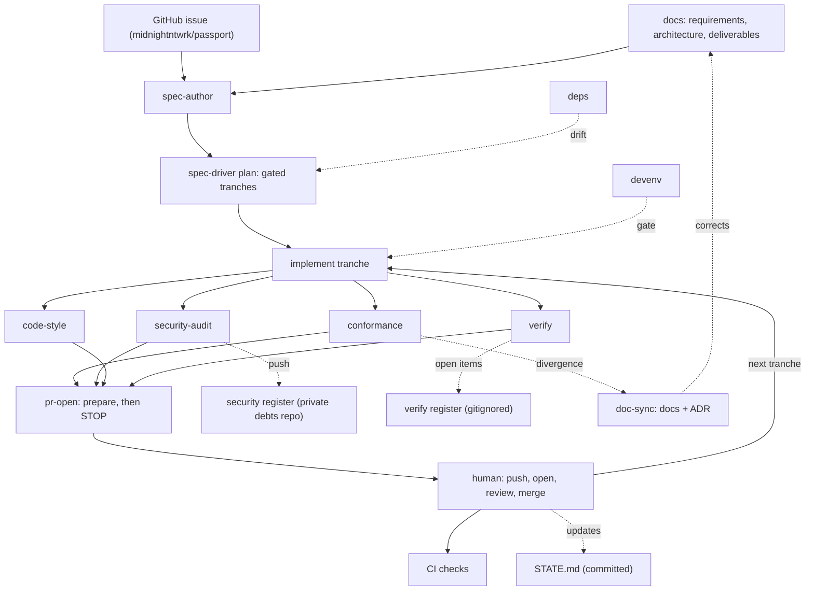

# Development workflow

> **Status:** draft · 2026/10/15
> **Owns:** how the team builds the SDK: the `mn-passport-skills` plugin, the
> tranche loop, `STATE.md`, the registers, and the CI checks.
> **Companions:** [`sdk-requirements.md`](./sdk-requirements.md) (what the SDK
> must do) and [`architecture.md`](./architecture.md) (how the SDK is built).

## Summary

- The unit of work is a **feature spec**. A spec comes from the requirements,
  the architecture, and the deliverables proposal. It names a GitHub issue.
- `spec-author` writes the spec. `spec-driver` cuts it into **tranches**, one
  for each PR. Each tranche is 400 net changed lines or fewer (600 at most).
- For each tranche, the loop implements the change and runs 4 **review
  lenses**: conformance, security, style, and verify.
- `pr-open` prepares the branch and the PR description, and then it stops.
  **A human pushes, opens, and merges.**
- `STATE.md` is committed and shows done, in-progress, and backlog work. The
  registers of open risks are never committed to this repository.
- Skills judge. Hooks and CI enforce. The docs are the source of truth, and
  `doc-sync` keeps them true.

## Naming

| Prefix | What it is |
|---|---|
| `mn-passport-skills:<name>` | A development skill. The skills build the SDK. |
| `@midnight-ntwrk/mn-passport-*` | A runtime package. The packages are the SDK. |

One plugin, `mn-passport-skills`, holds the skills, the hooks, and the scripts.

## Principles

1. **Skills assist and judge. Hooks and CI enforce.** A rule that must always
   hold goes into a hook or a CI job, because a model cannot guarantee it.
2. **The docs are the source of truth.** A spec is derived from the docs.
   Conformance checks code against the docs. `doc-sync` corrects the docs when
   the code shows that they are wrong.
3. **Two feedback loops.** `verify` asks "does it run?". `doc-sync` asks "are
   the docs wrong?". Without these loops, the code and the docs drift apart.
4. **No outward action from the loop.** The loop prepares work. The human
   pushes, opens, and merges. The one exception is the push of the security
   register to the private debts repository.

## Where specs come from

A new feature spec is authored from these sources:

- [`sdk-requirements.md`](./sdk-requirements.md): the requirements and the
  normative rules.
- [`architecture.md`](./architecture.md): the packages, the seams, the adapters,
  and the dependency rules.
- [`provider-integration.md`](./provider-integration.md): the contract with the
  WaaS provider and the proving & settlement service.
- The deliverables proposal
  ([`2026-09-25-sdk-deliverables.md`](./proposals/2026-09-25-sdk-deliverables.md)).
  Each spec names the deliverable IDs (D1, D2, and so on) that it serves.

The roadmap folder ([`roadmap/roadmap.md`](./roadmap/roadmap.md)) holds the plan
when the team rebuilds it. Until then, the deliverables proposal sets the order:
the foundation lane first, then the other lanes in parallel.

The docs themselves come from the Midnight Passport planning workspace, the
`midnightntwrk/passport` repository. Conformance also checks changes against
that workspace.

## The skills

| Skill | Role | When it runs |
|---|---|---|
| `spec-author` | Writes a feature spec | Before planning |
| `spec-driver` | Plans tranches, then runs the loop | For each spec |
| `conformance` | Design lens | For each tranche, and at plan time |
| `security-audit` | Key-management lens | For each tranche |
| `code-style` | Conventions lens | For each tranche |
| `verify` | "Does it run?" lens | For each tranche |
| `doc-sync` | Corrects the docs and records an ADR | On a justified divergence |
| `pr-open` | Prepares the branch and the PR, then stops | After the lenses pass |
| `deps` | Dependency watcher | On a schedule, and on each dependency change |
| `devenv` | Environment gate | Before each tranche |

### Spine

**`spec-author`** expands the sources into one full spec. The spec has these
parts:

- objective and scope;
- decisions, each with a citation to a source doc;
- interfaces and the flow;
- dependencies and external gates;
- acceptance criteria and a verify plan;
- a proposed tranche outline, open questions, and the GitHub issue.

It derives each normative statement from the docs and does not invent rules.
If the docs are silent, it records an open question and flags `doc-sync`. If
the spec has no issue, it stops and asks. It writes no code and makes no
outward action.

**`spec-driver`** has two phases:

- **Plan.** It confirms the issue, or it stops and asks. It applies the
  conformance rules, so the plan follows the layering of the architecture.
  It cuts the spec into ordered tranches. Each tranche has a goal, the
  expected files, a size estimate, and an acceptance gate. A plan with a
  tranche over budget is not valid, and the skill splits it again. It adds
  all tranches to the `STATE.md` backlog.
- **Loop.** For each tranche, it runs the steps in
  [The loop for each tranche](#the-loop-for-each-tranche).

### Review lenses

The 4 lenses run in parallel. Each lens can also run alone. Each lens
classifies a finding as blocking, advisory, or a divergence.

**`conformance`** checks the change against `sdk-requirements.md`,
`architecture.md`, and the planning workspace. It checks the dependency rules,
the kernel invariant, the naming, and these normative rules:

| Rule | What conformance checks |
|---|---|
| Ceremony gate | A passkey tap occurs when Passport issues a grant and when the handoff completes. There is no tap for each call, unless the grant key is a passkey on the origin of the dApp. |
| Prover disclosure | In V1, the prover gets the unproven transaction and sees the coin and the amount. The user is told this. Encryption to an enclave becomes mandatory when a trusted-hardware prover exists. |
| Deposit, not address | A payment to an account is a deposit contract call, never a transfer to a raw ACC address. Unshielded value goes in through `deposit_unshielded`. |
| No `core` in clients | `connect` and `mn-passport-agent` never link `core` or a Passport-app adapter. Shared code goes into `mn-passport-account`. |
| Two version axes | The wire axis (`mn-passport-protocol`, the grant messages) and the binding axis (`mn-passport-contract` and the deployed ACC) stay separate. |

A decided component of the planning workspace wins over a stale SDK doc. In
that case, conformance reports a divergence and routes it to `doc-sync`.

**`security-audit`** reviews key management. It has two outputs:

1. **Blocking findings**, which the loop fixes before `pr-open`. Examples: a
   secret outside the kernel; no ceremony gate at grant issuance or at the
   handoff; a secret in a log; a dApp or an agent with more than its grant key.
2. **Residual risks**, which the team cannot fix now. The skill appends them to
   the security register in the private repository `../mn-passport-sdk-debts`,
   and then it commits and pushes there. Each entry states the risk, why it
   cannot be fixed yet, and the mitigations.

It records the accepted risks of the design when the related code lands. One
example is the V1 prover that sees the coin and the amount.

**`code-style`** checks the project conventions. These include the spelling
and date rules, the Midnight brand, and the TypeScript rules. The TypeScript
rules are: no `any`, `unknown` only with a reason and an owner, no
module-global singletons, and one error taxonomy. Format and lint are CI jobs,
not review comments.

**`verify`** drives the affected flow for real. It builds, runs the tests, and
then proves and submits on a devnet. A change that passes the other lenses but
does not prove or submit is not done. It records open validations in the
verify register.

### Feedback

**`doc-sync`** runs when the code diverges from the docs for a good reason. It
updates the docs and records an ADR in [`adr/`](./adr/). It also sweeps the
verify register: it closes the entries that the new learning settles. If the
change makes a conformance check wrong, it updates that skill in the same PR.

### Ship

**`pr-open`** runs the size check with the same script and numbers as CI. Over
400 net lines, it warns and needs a justification in the PR. Over 600, it
stops and proposes a split. It prepares the branch, the commits, and the
description. If the spec has an issue, the description carries `Refs #NN`, or
`Closes #NN` on the last tranche. Then it stops and gives the human a
pre-filled compare URL and a copy of the description.

### Watchers

**`deps`** keeps dependencies safe and pinned:

- **7-day cooldown.** It never adopts a version that is less than 7 days old.
  It reads the publish time with `npm view <name> time`. The only exception is
  an urgent security patch. The PR records it with a `Cooldown-override:` line.
- **Exact pins** with a committed lockfile. No `^` or `~`, and no custom
  registry configuration.
- **Toolchain pins.** The build pins one midnight-js version and states which
  behavior it uses. It also pins the exact zkir and midnight-zk crate
  revisions, because proving keys change with the crate revision.
- **Compatibility matrix.** It keeps the two version axes current. A bump that
  moves an axis updates the matrix in the same PR.

It turns drift into backlog items through `spec-driver`. It never bumps a
dependency silently inside an unrelated tranche.

**`devenv`** checks the environment before a tranche starts:

- the private debts repository is present and can receive a push;
- the local dev origin serves HTTPS, because passkeys need a secure context;
- the devnet, the proof server, and the Compact CLI are ready;
- the Node toolchain and the lockfile match the repository.

### Not skills

- **A generic code review.** The harness review commands do this. The lenses
  hold the project rules only.
- **The merge decision.** A human makes it.

## The loop for each tranche

1. `devenv` confirms that the environment is ready.
2. `spec-driver` moves the tranche to **In progress** in `STATE.md`.
3. The agent implements the tranche. If the diff goes past 600 lines, it stops
   and splits.
4. The 4 lenses run in parallel. The agent fixes each blocking finding and runs
   the lens again.
5. `security-audit` pushes residual risks to the debts repository. `verify`
   and `doc-sync` update the local verify register.
6. If the code diverges from the docs for a good reason, `doc-sync` updates
   the docs and records an ADR.
7. `pr-open` prepares the branch and the description, and stops.
8. The human pushes and opens the PR. CI runs. The human reviews and merges.
9. `spec-driver` moves the tranche to **Done**, with the PR and issue links.

A tranche that slips, blocks, or leaves scope goes to the backlog with a
reason. The loop never drops work silently.

### Review on the PR

With an authenticated GitHub CLI, the review happens on the PR:

1. The developer leaves review comments on GitHub.
2. The developer asks the agent to read the comments of the PR.
3. The agent proposes a fix and its reasons. It commits nothing before the
   human agrees.
4. After the human agrees, the agent commits with explicit paths. It pushes and
   replies on the thread only on the instruction of the human.

Without the CLI, the agent reads the public REST API and gives pre-filled
compare URLs.

## `STATE.md`

[`STATE.md`](../STATE.md) at the repository root is the committed record of
progress. `spec-driver` updates it at each tranche transition. It has three
parts:

| Part | Content |
|---|---|
| Done | Completed tranches, each with its PR and issue links |
| In progress | The one tranche in the loop now |
| Backlog | Planned tranches that are not complete, each with a reason |

## Issue traceability

The chain is issue, then spec, then tranches, then PRs, then `STATE.md`.

- Each spec names a GitHub issue in `midnightntwrk/passport`. Without an issue,
  `spec-author` and the `spec-driver` plan phase stop and ask.
- `pr-open` adds `Refs #NN` or `Closes #NN` to the PR description when an issue
  exists.
- CI does not check the issue reference.
- Each `STATE.md` entry carries its issue number.

## Registers

| Register | Owner | Location | Committed |
|---|---|---|---|
| Security register | `security-audit` | `../mn-passport-sdk-debts` (private repository) | There only, never here |
| Verify register | `doc-sync`, fed by `verify` | `.mn-passport-skills/verify-register.md` | No, gitignored |

Both registers only grow. A resolved entry is marked as resolved, with a date
and a PR. Nobody deletes it.

## Enforcement (hooks and CI)

| Check | Where | Behavior |
|---|---|---|
| Outward-action guard | Plugin hook | `git push`, `gh pr create`, `gh pr merge`, and `npm publish` from the agent need a human confirmation. |
| Tranche budget | CI and `check-diff-size.sh` | Counts net changed lines. Lockfiles, generated code, test fixtures, and `experiments/` do not count. In CI, 400 and 600 are warnings. Locally, the script fails past 600. |
| 7-day dependency cooldown | CI and `check-dep-cooldown.mjs` | Rejects a lockfile with a version less than 7 days old, unless the PR has a `Cooldown-override:` line. |
| Cooldown at install | `pnpm-workspace.yaml`, `.npmrc` | pnpm and npm refuse versions less than 7 days old. Exact pins and no install scripts. |
| Registers never tracked | CI | Fails if a path under `.mn-passport-skills/` is tracked or no longer gitignored. |
| Lint, format, build, and test | CI | All must pass. |

A human decides to merge an exceptional PR over budget, such as a migration.

## Readability standard

Each doc in `docs/` follows these rules:

- **Shape.** A header block with status, date, and what the doc owns. A summary
  first. One topic for each section, with heading depth three at most. Open
  questions near the end. Sources last.
- **Language.** ASD-STE100 Simplified Technical English: sentences of 25 words
  or fewer, paragraphs of six sentences or fewer, active voice, and no
  contractions. Use `must` for a rule and `can` for a possibility.
- **Spelling.** American English, the Oxford comma, and dates as `YYYY/MM/DD`.
  Code identifiers and quoted titles keep their spelling.
- **Content.** Describe the current design only. History goes in ADRs and git.
  Use no vendor names: write "the WaaS provider" and "the proving & settlement
  service".
- **Scanning.** Tables for parallel items, one Mermaid diagram for each main
  flow, and few reference codes in the text.

A checker script, `mn-passport-skills/scripts/check-ste.py`, is planned. It
will check sentence length, paragraph length, contractions, and unapproved
words. It is not in the repository yet.

## Open questions

1. **Release skill.** A future `release` skill will bump versions, write the
   changelog, and publish the compatibility matrix. It starts after the loop
   is proven.
2. **STE checker in CI.** When `check-ste.py` lands, does CI run it on each
   changed doc?

## Sources

- [`sdk-requirements.md`](./sdk-requirements.md): the normative rules.
- [`architecture.md`](./architecture.md): the dependency rules and the kernel
  invariant.
- [`provider-integration.md`](./provider-integration.md): the provider contract.
- SDK deliverables:
  [`2026-09-25-sdk-deliverables.md`](./proposals/2026-09-25-sdk-deliverables.md).
- SDK realignment:
  [`2026-09-25-sdk-realignment.md`](./proposals/2026-09-25-sdk-realignment.md),
  the normative rules and the external dependencies.
- The skills: `mn-passport-skills/skills/*/SKILL.md`.
- The CI checks: `.github/workflows/pr-checks.yml`, `mn-passport-skills/scripts/`.
- [`CLAUDE.md`](../CLAUDE.md): the short orchestration guide.
