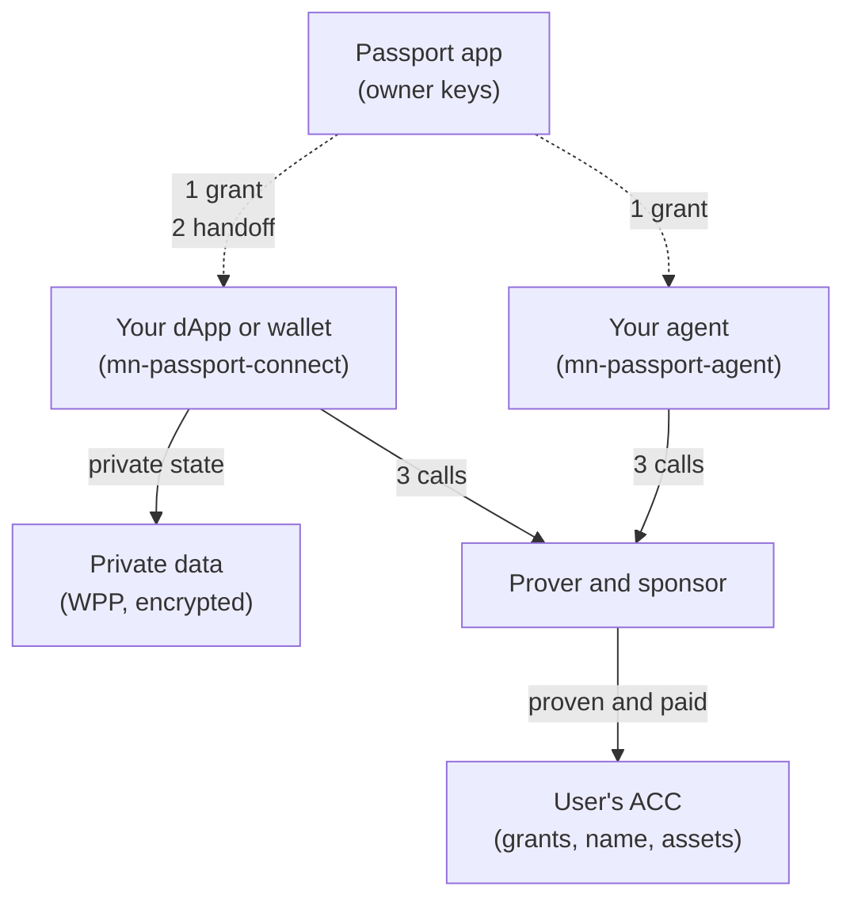

# Integrating with Midnight Passport

> **Status:** draft · 2026/11/11
> **Owns:** what a dApp, an agent, or a wallet must support to work with
> Midnight Passport.
> **Companions:** [`architecture.md`](./architecture.md) (how the SDK is
> built), [`sdk-requirements.md`](./sdk-requirements.md) (what it must do),
> and [`roadmap.md`](./roadmap/roadmap.md) (when each part lands).

This is a first guide for dApp and wallet teams who want to support Passport.
It says how we expect the integration to work, not the final API. The SDK is
in development: each requirement below names the roadmap milestone that
delivers it. We will work closely with the first partners, and this guide will
change with what we learn.

## Why integrate

- **Users without wallet friction.** A Passport user has no seed phrase and
  never holds DUST: a sponsor pays the fees (rule 14). A new user can create a
  Passport from your dApp or wallet and come straight back.
- **Scoped access, not full custody.** Your dApp or wallet gets a grant: its
  own key, limited to the operations, assets, caps, and expiry the user
  approved. The ACC enforces the limits on chain, on every call.
- **Works with Passport closed.** After the grant, you sign with your own grant
  key. The user taps their passkey once, at the grant, not on every call
  (rules 1 and 9).
- **Private data that survives a lost device.** Passport backs up and restores
  your dApp's private state, if you use its provider.

## How it works

Each user has an **Account Custody Contract (ACC)** on Midnight. It holds the
user's owner keys, the grants, the name, and the assets. Only the Passport app
holds owner keys. Every other client, whether a dApp, an agent, or a wallet,
holds a grant.

1. **Connect.** Your client sends the user to the Passport app with a grant
   request. The user approves it with one passkey tap, and Passport issues the
   grant on the ACC.
2. **Hand off.** With a separate consent, Passport gives your client the key
   to its own private-data package, and nothing else.
3. **Operate.** Your client signs calls with its grant key. The prover proves
   them and the sponsor pays the fees and broadcasts. Passport is not on the
   path.

## For dApps

A dApp has five things to do. The SDK aims to make them about as easy as the
Midnight dApp connector API.

| # | Requirement | What it means | Milestone |
|---|---|---|---|
| 1 | **Authorize through the ACC** | Your contract treats the user's ACC as the account. It gates each user action on a scoped grant, through a contract-to-contract call into the ACC. Anything the user owns in your contract, such as a share of a liquidity pool, belongs to the ACC, not to a wallet key. | Foundation (the ACC interface) |
| 2 | **Compile against the ACC artifact** | Your contract imports the published ACC circuit interface, and you compile it together with the ACC artifact. `mn-passport-contract` checks the artifact against its manifest. Where the artifact is published is still being decided. | Foundation |
| 3 | **Call the ACC in every transaction** | In your UI, each Passport transaction includes the call into the ACC, signed with the grant key. `mn-passport-connect` supplies the ACC interface, the challenge, and the grant signature; your code composes the call. A shielded spend from the ACC needs its own intent, which the transaction joiner combines with yours. | Execution |
| 4 | **Accept injected private state** | Your witnesses read and write private state through a midnight-js `PrivateStateProvider`. For a Passport user, use the provider from Passport: your witness code does not change, and Passport backs the state up. For other users, keep your usual provider. A dApp that keeps its own state can still use Passport, but gets no backup, sync, or recovery. | Private data and sync |
| 5 | **Send new users to Passport** | A dApp never creates accounts (rule 11). A user without a Passport goes to the Passport app, like an OAuth sign-up, creates an account, approves your grant in the same visit, and is redirected back. | Integrations |

Two more rules apply to every dApp:

- **Pay a Passport with a deposit call**, never a transfer to its address
  (rule 3). `connect` provides Pay with Passport.
- **Write private state after `SucceedEntirely`** only. If the write fails,
  keep the state locally and retry (rule 8).

## For agents

An agent follows the dApp model, with `mn-passport-agent` on Node.js. The user
approves its grant from a QR code or a link, and the agent operates with
Passport closed. It reads its grant on chain before each action.

An agent is headless, so it has no dApp code of its own. It downloads the
artifacts of the dApp it acts on from a registry, by content hash, and checks
the verifier key against the chain. At first, Passport will support a short
list of dApps whose artifacts it publishes. The dApp team publishes its
artifacts and their hashes.

## For Midnight wallets

A wallet works with Passport like a dApp: it is a client with a grant. It
never holds an owner key, and it cannot add or remove grants. Only the user,
in the Passport app, does that.

| # | Requirement | What it means | Milestone |
|---|---|---|---|
| 1 | **Onboard through Passport** | The same redirect as a dApp. A new user creates a Passport in the Passport app, approves the wallet's grant in the same visit, and returns to the wallet. | Integrations |
| 2 | **Spend under a grant** | The wallet spends from the ACC within the grant's limits, for example to pay a merchant on the user's behalf. | Execution |
| 3 | **List assets with the viewing key** | To show balances and history, the wallet asks for a read grant. With a separate consent, Passport gives it the viewing key, and the wallet reads the account's assets from the indexer. Revoking the grant rotates the key (rule 13). | Account recovery (the read-access lifecycle) |
| 4 | **Use the Passport provider for private state** | A wallet does not manage a dApp's private state. The dApp keeps it through the Passport provider (dApp requirement 4). | Private data and sync |

A user can also add their own Midnight wallet as an owner key, but only from
the Passport app. That is account management, not an integration.

## For wallets on other chains

A wallet on another chain needs the three Midnight wallet requirements above,
plus a translation layer: an RPC service that reads the ACC state with the
viewing key and returns it in the formats the wallet already uses. That lets
the wallet show a Passport like any other account. This is a direction, not yet
in the architecture.

Signing has limits today. An external wallet can sign for the ACC only on an
arm the ACC verifies: EIP-191 and Ed25519 wallets are not supported yet. After
V1, `mn-passport-ecosystems` puts Passport in the wallet pickers of other
chains ([`architecture.md`](./architecture.md), example 8).

## Coding-agent skills

The SDK will ship development skills for coding agents, so a team can integrate
by asking its agent: a starter project with `connect`, the browser adapter, the
remote prover, and the broadcast adapter already wired, and skills that guide
the contract, UI, and private-state changes above.

## Learn more

- [`architecture.md`](./architecture.md): the packages, and the examples of a
  dApp connection, an agent call, and a payment.
- [`sdk-requirements.md`](./sdk-requirements.md): the ACC, the grants, the
  normative rules, and the external wallet support.
- [`roadmap/roadmap.md`](./roadmap/roadmap.md): the milestones.
- The repository: <https://github.com/midnightntwrk/midnight-passport-sdk>.
