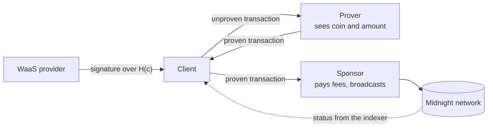
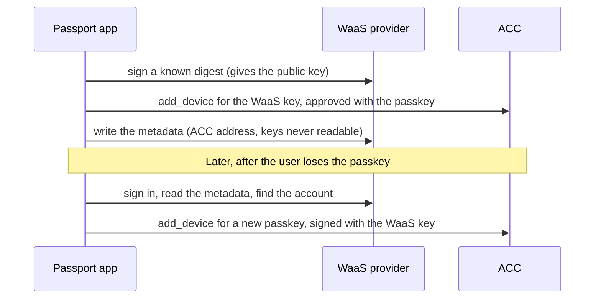

# Provider integration

> **Status:** draft · 2026/10/19
> **Owns:** the contract between the SDK and its external services: the WaaS
> provider, the prover, the sponsor, and the Capacity Exchange.
> **Companions:** [`sdk-requirements.md`](./sdk-requirements.md) (what the SDK
> must do) and [`architecture.md`](./architecture.md) (the seams and the
> adapters that call these services).

## Summary

- **The WaaS provider** holds an optional backup owner key of the user. It signs
  raw ACC challenges (k256, envelope 0), and it keeps small account metadata on
  that key.
- **Only the Passport app uses the WaaS key.** The provider isolates it to the
  Passport app, and a dApp never drives it.
- **The prover** takes an unproven transaction and returns the proven
  transaction. It holds or makes again the proving keys. In V1, it sees the
  coin and the amount, and the user is told.
- **The sponsor** pays the fees and broadcasts. A user never holds DUST. The
  **Capacity Exchange** is the second fee route, and it comes later.
- If the user enables the backup key, the WaaS provider needs the most trust.
  The account is only as safe as the signing security of the provider.

## The services

Each service sits behind a seam, and each one is replaceable.

| Service | What it does | What it can see or do | Called through |
|---|---|---|---|
| WaaS provider (optional) | Holds the backup owner key of the user, signs ACC challenges, and keeps account metadata | It holds a full-authority key, isolated to the Passport app. It reads the public metadata. | `adapter-waas` |
| Prover | Turns an unproven transaction into a proven transaction | The coin and the amount of each transaction | `adapter-prover-remote` |
| Sponsor | Pays the fees and broadcasts the proven transaction | The proven transaction | `adapter-broadcast` |
| Capacity Exchange | Sells DUST capacity for a token that the user holds | The amount class and the payment token of a quote | `adapter-fee-capacity-exchange` |

## The WaaS provider

The WaaS key is an optional backup owner key. The user adds it in the Passport
app, after the passkey becomes the first owner key. The key has the same
authority as the passkey, and it works alone. Thus, it adds trust in the
provider. A dApp never drives it.

### What the provider must supply

The Passport app enrolls the key of a WaaS provider only if the provider
supplies all of these functions:

1. It holds a key for the user. The code of a dApp never holds that key.
2. It signs a raw 32-byte digest with that key (ECDSA over secp256k1).
3. **It isolates the key to the Passport app.** It gives Passport a key or
   session that no other origin can use. Or, it enforces a signing policy that
   refuses each ACC owner operation from another origin.
4. It keeps metadata on the key of the user. The sign-in of the user can read
   and write it from each origin that the provider serves.
5. It lets the Passport app sign in as the same user.

A provider that cannot sign a raw digest cannot enroll on the ACC. A provider
that cannot isolate the key does not become a backup owner key.

### Signing ACC challenges

The key of the provider is a device on the k256 arm, with envelope 0. For each
operation, the SDK builds the 32-byte challenge `c` from the arguments of the
circuit. The provider signs the digest `H(c)`, where `H` is SHA-256. It needs
no contract runtime, prover, or node. The ACC verifies the signature in the
circuit. [`sdk-requirements.md`](./sdk-requirements.md) owns the exact digests.

**Enrollment from a signature.** The provider has no call that returns the
public key. Thus, the SDK asks for a signature over a known digest, and it gets
the public key from that signature. The passkey then approves `add_device` for
that key. The envelope stays 0 for the life of the key.

### Account metadata

Each origin of the provider can read the metadata. Thus, it has two parts.

| Rule | Detail |
|---|---|
| Public part | The ACC address. It finds the account. |
| Secret part | The viewing key and the WPP account key, never in readable form. The provider keeps them in a part that only the Passport app can read. Or, the app encrypts them under a key that no other origin of the provider can get. |
| Never | Private state |
| Size | Small. Some providers keep only about 2 KB. |
| Namespace and version | Each entry has a namespace and a version. |
| Write | Read, merge, write, and then read back. A write that does not read back is a failure. |

A dApp that signs in with the same provider never gets the viewing key from the
metadata. It gets the key only through a read grant, after consent.

The account-metadata seam in `mn-passport-account` defines these operations.
`adapter-waas` implements them for one provider. The adapter names no vendor.

### Recovery with the backup key

If the user loses the passkey, the user signs in to the Passport app with the
same provider. The public metadata finds the account. Then the Passport app
restores three things:

- signing: the backup key approves a new passkey (`add_device`);
- the viewing key, which opens the payments that senders sealed earlier;
- the private state, through the WPP account key.

### Who uses the key

| Who | When | Operations |
|---|---|---|
| The Passport app | Owner operations and recovery | Issue and revoke grants, add and remove devices, and approve a new passkey |
| A dApp | Never | The dApp acts only through its grant key |
| An agent | Never | The agent acts only through its grant key |

### Acceptance checks

The `adapter-waas` spec has these checks:

1. After enrollment, a dApp session with the same provider cannot get a
   signature for an owner operation, for example `add_device`.
2. A dApp without read consent cannot recover the viewing key from the
   metadata.
3. A recovery with the backup key restores signing, the viewing key, and the
   private state.

### Custody disclosure

When the user enables the backup key, the Passport app tells the user two
facts:

- The provider holds a full-authority key for the user. Thus, the account is
  only as safe as the signing security of the provider.
- If the provider keeps the viewing key in a part that only Passport can read,
  the provider itself can read it. Then it can see what the account receives.
  The viewing key alone gives no authority to spend.

## The prover

### Transaction in, proof out

The prover seam is `prove(unprovenTx, circuitIds) → provenTx`. It lives in
`mn-passport-account`, and `adapter-prover-remote` implements it. The Passport
app, dApps, and agents use the same seam.

The client never uploads a proving key. It loads only the compiled module, the ledger decoder, and the manifest,
about 1 MB for each contract.

### Proving keys

The prover holds the proving keys. It can also make each key again from the
ZKIR and the on-chain verifier key. The result is byte-identical to the key
that the compiler makes. The step needs no SRS.

Measured on a 30-circuit build of the reference account (2026/09/23):

| k | Proving key | Make the key again from the on-chain verifier key |
|---|---|---|
| 13 | 11 MB | 0.04 s |
| 16 | 112 MB | 0.33 to 0.47 s |
| 17 | 224 MB | 0.72 to 1.35 s |

All proving keys of that account total 3.5 GB, against 928 KB of ZKIR. The
prover still needs the SRS to prove: 25 MB at k=17.

**Key identity.** A proving key depends on the exact zkir and midnight-zk crate
revisions, not on the version string. A different revision can make a different
key from the same ZKIR. The on-chain verifier key shows the mismatch, because
the node rejects the proof. It does not repair the mismatch. Thus, the prover
must use the crate revisions that the version registry records.

### What the prover sees

The prover gets the unproven transaction. Thus, it sees the coin and the
amount of each transaction. The SDK must tell the user this. Encryption of the proving input to an enclave becomes mandatory when a
trusted-hardware prover exists. Until then, the disclosure applies.

## Fees and broadcast

### The sponsor

A user never holds or pays with DUST. The broadcast seam in `mn-passport-account` takes the proven transaction.
`adapter-broadcast` gives it to the sponsor. The sponsor adds the fee payment
and broadcasts the transaction. The sponsor also pays the fees of account
creation and the opening balance.

### Monitoring until final

The client monitors each transaction until it is final. A chain subscription
can stop without an error, for example after a network change. Thus, these
rules apply:

- **Bounded waits.** Each wait on the chain has a limit. At the limit, the
  client asks the indexer, and it stops waiting for an event.
- **Resubmission.** When a transaction does not arrive, the client submits the
  same transaction again. A node answer that it already holds the
  transaction is not a failure.
- **The indexer decides.** The client knows the transaction identifier before
  it submits. It reads the result from the indexer.

### The Capacity Exchange

The Capacity Exchange is the second fee route, and it comes later. The SDK
gets quotes off chain from liquidity providers, and the user selects one. The
liquidity provider returns a partial transaction, and the SDK adds the intent
of the user. `adapter-fee-capacity-exchange` must handle quote expiry, replay, and abandoned
quotes. It must ask only trusted providers, because a quote request shows the
amount class and the payment token. NIGHT that a contract holds cannot make
DUST, so this route matters for funds in the ACC.

## Open questions

1. **The activation guard.** _Closed 2026/10/19._ A dApp never onboards a user,
   so no dApp drives the WaaS key (realignment open question 15).
2. **The WaaS key scheme.** Does the provider enroll on k256 with envelope 0,
   or on p256 within the `wa-json134` profile (realignment open question 11)?
3. **The viewing key.** Is the WaaS metadata its route, or is a different
   route better (realignment open question 4)?
4. **The metadata schema.** The namespace names, the version format, and the
   merge rule for each field are not fixed. The provider can keep a part that
   only Passport can read, or Passport encrypts the secret part. Which route,
   and which key, depends on the provider.
5. **A proof server that makes keys from ZKIR.** No proof server has this mode.
   Nobody tested if a proof server accepts keys made from ZKIR only.
6. **The resubmission path.** Does the client resubmit through the sponsor, or
   directly to a node?
7. **Sponsor policy.** Which calls does the sponsor pay for, and which limits
   stop abuse?
8. **The trusted-hardware prover.** Which encryption scheme does the client
   use, and how does it pin the key of the enclave?

## Sources

- [Realignment proposal](./proposals/2026-09-25-sdk-realignment.md) §4, §6 to
  §9, §12, and §13; [deliverables](./proposals/2026-09-25-sdk-deliverables.md)
  D3, D16, and §6.
- ADR [0004](./adr/0004-artefact-hashes-committed-compiler-deterministic.md)
  (committed artifact hashes).
- Planning workspace (`midnightntwrk/passport`): PR #170
  (`experiments/proving-key-regeneration/`), PR #180 (signing digests), and
  `contract/contracts/account.compact` (`envelope_digest`).
- midnight-ledger PR #770 (keys from disk); servicedesk issue #203 (key sizes).
- Bounded waits and resubmission: the reference demo (`chainWait.ts`).
- Capacity Exchange: the upstream sponsor design (pre-launch).
